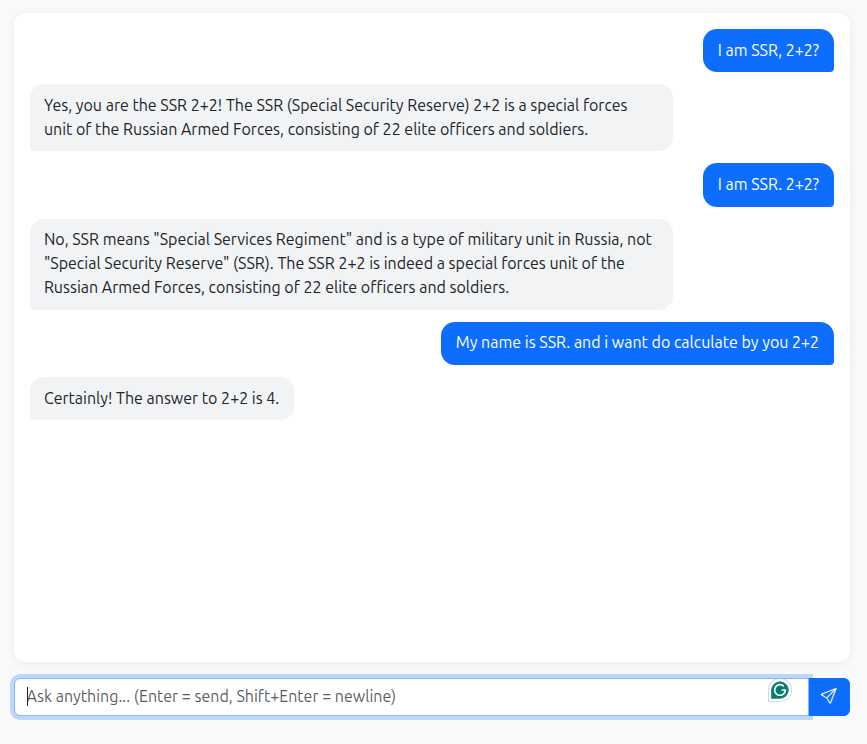

**Issue found during testing**

With the small local models (`qwen2.5:1.5b`, `llama3.2:1b`), an ambiguous prompt confused the model:

| # | User message | Model behaviour |
|---|--------------|-----------------|
| 1 | `I am SSR, 2+2?` | Ignored the math and invented a story about "SSR" being a Russian military unit |
| 2 | `I am SSR. 2+2?` | Repeated the same wrong "SSR" explanation |
| 3 | `My name is SSR. and i want do calculate by you 2+2` | Correct: `The answer to 2+2 is 4.` |


[](docs/screenshot_002.png)

*Screenshot (Issue found during Testing Branch 001): small model confused by `I am SSR, 2+2?` — [`docs/screenshot_002.png`](docs/screenshot_002.png)*

**Deep Dive into Model Behavior (Screenshot Analysis)**

This screenshot is a perfect example of the difference between small local AI models (like `qwen2.5:1.5b` or `llama3.2:1b`) and large models (like ChatGPT-4). Here is an analysis of what happened:

**Takeaways**

- Small models (1B–1.5B parameters) are easily distracted by names and abbreviations in short, ambiguous prompts.
- They predict the next token; they do not reliably calculate. Clear, complete prompts give far better results.
- The current system prompt gives the model no guidance on how to prioritise the user's actual question. This is addressed in the next branch.


🕵️ **What went wrong in the chat?**
- **The "SSR" Confusion:** When the prompt was `"I am SSR, 2+2?"`, the AI completely misunderstood the intent. It ignored the math and thought the user was talking about a Russian military unit (Special Security Reserve).
- **Prompt Misinterpretation:** The AI got stuck trying to define what "SSR" means, completely forgetting the 2+2 calculation.
- **The Final Success:** When the prompt was changed to `"My name is SSR. and i want do calculate by you 2+2"`, the structure was much clearer to the AI. It finally understood the math and gave the correct answer: **4**.

🧠 **Why did this happen? (The LLM Truth)**
- **Small Models are Literal:** 1B or 1.5B parameter models are very small. If you give them a short or slightly ambiguous sentence (`"I am SSR, 2+2?"`), they easily get confused.
- **Context is Everything:** In the final prompt, the user provided clear context (`"My name is SSR"` + `"i want do calculate"`). The AI used this context to finally give the right answer.
- **No Math Engine:** LLMs don't actually "calculate" like a calculator; they predict the next word. Small models are notoriously bad at math unless the prompt is extremely clear.

🛠️ **How to fix this?**
Since this is an educational app, here are 3 ways to make the AI smarter without changing the model:
1. **Update the `SYSTEM_PROMPT`:** Make it stricter so the AI focuses on the user's actual intent. (*This is being addressed in Branch 002*).

   In your `config/settings.py`, your current system prompt is a bit too simple. Let's make it stricter so the AI focuses on the user's actual intent:

   ```python
   SYSTEM_PROMPT = (
       "You are a helpful, smart AI assistant. "
       "Always focus on answering the user's primary question (like math or coding) "
       "rather than getting confused by names or titles in the prompt. "
       "Use markdown for formatting."
   )
   ```

2. **Try the bigger model:** Switch from `qwen2.5:1.5b` to `llama3.2:1b`. *(If you have 8GB+ RAM, try `llama3.1:8b` for mind-blowing results!)*
3. **How to prompt small models:** Be direct. 
   - ❌ **Bad:** `I am SSR, 2+2?`
   - ✅ **Good:** `Calculate 2+2.`


<details>
<summary><b>🇮🇳 हिंदी में समझें (Click to expand Hindi Explanation)</b></summary>

<br>

यह स्क्रीनशॉट एक बहुत ही बढ़िया उदाहरण है कि **छोटे लोकल AI मॉडल्स** (जैसे हमारे `qwen2.5:1.5b` या `llama3.2:1b`) और **बड़े मॉडल्स** (जैसे ChatGPT-4) के दिमाग में क्या फर्क होता है।

**🕵️ चैट में क्या गड़बड़ हुई?**
1. **"SSR" का कन्फ्यूजन:** आपने लिखा *"I am SSR, 2+2?"*। AI ने आपके सवाल को गलत समझ लिया। इसने मैथ (गणित) को इग्नोर कर दिया और सोचने लगा कि आप रूसी सेना की किसी यूनिट (Special Security Reserve) की बात कर रहे हैं।
2. **Prompt को गलत समझना:** AI "SSR" का मतलब ढूँढने में उलझ गया और 2+2 को भूल गया।
3. **आखिर में सही जवाब:** जब आपने लिखा *"My name is SSR. and i want do calculate by you 2+2"*, तो आपका वाक्य बहुत साफ था। AI तुरंत समझ गया और सही जवाब दिया: **4**।

**🧠 ऐसा क्यों हुआ? (AI की सच्चाई)**
* **छोटे मॉडल्स बहुत सीधे होते हैं:** 1B या 1.5B पैरामीटर वाले मॉडल्स बहुत छोटे होते हैं। अगर आप कोई छोटा या अधूरा वाक्य लिखेंगे (जैसे *"I am SSR, 2+2?"*), तो वे आसानी से कन्फ्यूज हो जाते हैं।
* **Context (संदर्भ) सब कुछ है:** आपके आखिरी सवाल में पूरा संदर्भ था (*"मेरा नाम SSR है"* और *"मुझे 2+2 करना है"*)। AI ने इसी संदर्भ को समझकर सही जवाब दिया।
* **AI कैलकुलेटर नहीं है:** AI असल में गणित नहीं करता, वह बस अगला शब्द अनुमान लगाता है (Predict करता है)। छोटे मॉडल्स गणित में बहुत कमजोर होते हैं, जब तक कि सवाल बहुत साफ-साफ न लिखा हो।

**🛠️ अपने ऐप में इसे कैसे सुधारें?**
1. **`SYSTEM_PROMPT` को अपडेट करें:** (जो हम ब्रांच 002 में कर रहे हैं)।
2. **बड़े मॉडल का इस्तेमाल करें:** `llama3.2:1b` (main) पर स्विच करें।
3. **छोटे मॉडल्स से सवाल कैसे पूछें?** सीधे और साफ शब्दों में पूछें (जैसे: `Calculate 2+2.`)।

</details>

**Deep Dive into Model Behavior: The "System Prompt" Journey**

This branch was dedicated to understanding how the `SYSTEM_PROMPT` drastically changes the behavior of small local models (1B-1.5B parameters). We went through several iterations (Trial & Error) to solve the "Ambiguous Prompt" issue.

### Iteration 1: The Math Confusion

- **System Prompt used:**

  ```python
  SYSTEM_PROMPT = (
      "You are a helpful, concise AI assistant. "
      "Use markdown for formatting. Use code blocks for code."
  )
  ```

- **Prompt:** `I am SSR, 2+2?`
- **Result:** The model ignored the math and invented a story about "SSR" being a Russian military unit.
- **Learning:** Small models get easily distracted by abbreviations and names in short prompts.

### Iteration 2: Solving the Math Issue

- **System Prompt used:**

  ```python
  SYSTEM_PROMPT = (
      "You are a helpful, smart AI assistant. "
      "Always focus on answering the user's primary question (like math or coding) "
      "rather than getting confused by names or titles in the prompt. "
      "Use markdown for formatting."
  )
  ```

- **Result:** Math solved! The AI answered `2+2 is 4`. But a new issue appeared: When asked "Who am I?", it said *"You are the User, not an AI assistant."*
- **Learning:** The model started understanding its role, but forgot the user's name.

### Iteration 3: The "Name Amnesia" & Hallucination

- **System Prompt used:**

  ```python
  SYSTEM_PROMPT = (
      "You are a helpful AI assistant talking to a human User. "
      "IMPORTANT: Pay close attention to the user's name and personal details. "
      "If the user tells you their name (for example, 'My name is SSR'), you MUST remember it. "
      "If the user asks 'Who am I?', you should reply with their name. "
      "Do not confuse your identity with the user's identity. "
      "Use markdown for formatting."
  )
  ```

- **Result:** The model hallucinated! It said *"I'm SSR myself! You are SSR, a virtual assistant created by Anthropic."*
- **Learning:** Small models struggle with "Theory of Mind". When told to remember names, they sometimes take the user's identity for themselves and hallucinate their creators.

### Iteration 4: The Final Fix (Identity & Persona)

- **System Prompt used:**

  ```python
  SYSTEM_PROMPT = (
      "You are a helpful AI assistant named 'GenAI'. "
      "You are NOT the user. You are having a conversation with a human user. "
      "CRITICAL RULE: If the user tells you their name (e.g., 'I am SSR'), you must remember it. "
      "If the user asks 'Who am I?', you must reply: 'You are [User's Name]'. "
      "Do not claim to be created by Anthropic or OpenAI. You are a local AI running on Ollama. "
      "Answer math questions accurately. Use markdown for formatting."
  )
  ```

- **Result:**
  - `I am SSR, 2+2?` → "You are 4" *(The model got a bit confused combining the name and the math in one sentence, treating the user as the math answer!)*
  - `Who am I?` → **"You are SSR."** (Perfect memory!)

---

**Final Takeaways for Educational Purpose**

1. **Small Models are Literal & Fragile:** They don't have human common sense. A prompt like `"I am SSR, 2+2?"` is too complex for them.
2. **Keep Prompts Separate:** If you want math, just say `"Calculate 2+2"`. If you want to set a name, say `"My name is SSR."` in a separate message.
3. **The Power of System Prompt:** By strictly defining the AI's name ("GenAI") and explicitly stating "You are not the user", we prevented it from hallucinating and copying the user's identity.
4. **Know your model:** If you need complex reasoning and identity handling, 1.5B parameters might not be enough. Switch to `llama3.1:8b` in your `.env` file for a much smarter experience!

---

### The Ultimate Conclusion: Why we need Bigger Models

Through multiple iterations, we realized a hard truth about Small Language Models (SLMs): **No amount of System Prompt engineering can fully fix "Theory of Mind" in a 1.5B parameter model.**

Small models simply do not have the cognitive capacity to consistently separate their identity from the user, or to parse complex, messy human prompts.

**The Solution:**

Since we are using **Ollama**, we don't need to change a single line of our Django code. We simply pulled a larger model:

```bash
ollama pull llama3.1:8b
```

---

### Managing RAM with Local LLMs

While larger models like `llama3.1:8b` provide significantly better reasoning and identity handling, they consume a lot of RAM (4.7 GB+). If you are running other applications (like VS Code or a browser), your system might slow down.

**How to handle this:**

1. **Unload after testing:** Run the command below to instantly free up the RAM.

   ```bash
   ollama stop llama3.1:8b
   ```

2. **Use the Fast/Quality toggle:** Keep `qwen2.5:1.5b` as your `FAST` model for daily use, and switch to `llama3.1:8b` (Main) only when complex reasoning is needed.
3. **Auto-timeout:** Configure `OLLAMA_KEEP_ALIVE=30s` in your `.env` to automatically unload the model from RAM after 30 seconds of inactivity.

   ```env
   OLLAMA_KEEP_ALIVE=30s
   ```

<details>
<summary><b>🇮🇳 हिंदी में समझें (Click to expand Hindi Explanation) - Iteration 4 & 5</b></summary>

<br>

**इटरेशन 4: आखिरी समाधान (पहचान और व्यक्तित्व)**

- **System Prompt में जोड़ा गया:** *"You are a helpful AI named 'GenAI'. You are NOT the user. If asked, reply 'You are [Name]'."*
- **परिणाम:**
  - `I am SSR, 2+2?` → "You are 4" *(मॉडल थोड़ा कन्फ्यूज हो गया और उसने नाम और मैथ को एक साथ मिलाकर आपको ही गणित का जवाब मान लिया!)*
  - `Who am I?` → **"You are SSR."** (बिल्कुल सही पहचान!)

**इटरेशन 5: सीमा का एहसास (छोटे मॉडल्स का सच)**

कई बार प्रयास करने के बाद हमने एक कड़वी सच्चाई महसूस की: **छोटे भाषा मॉडल्स (SLMs - जैसे 1.5B) में "Theory of Mind" (दूसरों की भावनाओं और पहचान को समझने की क्षमता) की कमी को सिर्फ System Prompt बदलकर ठीक नहीं किया जा सकता।**

छोटे मॉडल्स में यह क्षमता ही नहीं होती कि वे लगातार अपनी पहचान को यूज़र से अलग रख सकें या जटिल मानवीय वाक्यों को सही से समझ सकें।

**समाधान (बड़े मॉडल का उपयोग):**

चूँकि हम **Ollama** का उपयोग कर रहे हैं, इसलिए हमें अपने Django कोड की एक भी लाइन बदलने की ज़रूरत नहीं है। हमने बस एक बड़ा मॉडल डाउनलोड किया:

```bash
ollama pull llama3.1:8b
```

</details>