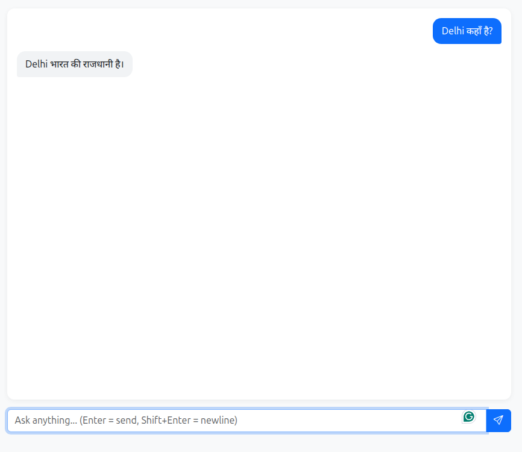

# Branch 003: `genai-chat-003-rag` (work in progress)

Until now the chatbot only knew what the model itself knew. In this branch I wanted to give it knowledge of my own, and I did not want to just plug in a framework and call it done. So I went in small steps: first turn text into vectors and look at the numbers, then store a few documents in a local ChromaDB, and finally feed the retrieved text back into the prompt.

Everything here runs locally on Ollama, same as the earlier branches. The embedding model is `nomic-embed-text`, the chat models are still the small `qwen2.5:1.5b` / `llama3.2:1b`.

---

## Part 1: What an embedding actually looks like

An embedding is just a list of numbers that represents a piece of text. For `nomic-embed-text` that list has 768 values. Two texts with similar meaning should end up pointing in a similar direction, and cosine similarity measures exactly that: the angle between the two vectors.

```text
cos(θ) = (A · B) / (‖A‖ × ‖B‖)
```

1.0 means the vectors point the same way. In theory 0 means unrelated, but as you will see below, real text almost never gets there.

### The experiment

I embedded four sentences, two Hindi and two English, and compared them with whatever the user types:

- `मुझे चाय पसंद है`
- `I love tea`
- `मुझे कॉफ़ी बहुत पसंद है`
- `The weather is nice today`

### Results

| User input | Best match | Score | What I take from it |
|------------|------------|-------|---------------------|
| `I love tea` | `I love tea` | 1.0000 | Sanity check. A sentence compared with itself. |
| `is tea good for helth` | `I love tea` | 0.7045 | Typo and all, it still lands on the tea sentence. |
| `I like softdrink` | `I love tea` | 0.4720 | Related-ish (both are drinks) but clearly weaker. |

The thing I did not expect: "unrelated" does not mean close to 0. `The weather is nice today` scores around 0.41 against a question about Delhi. In this setup, roughly 0.4 is the floor, and anything below about 0.5 should be treated as "not really related". I had assumed the scale would be more intuitive.

### Embedding score vs. what the LLM says

The embedding score and the chat answer are two separate things, and they disagreed in an interesting way.

1. Prompt: `I love tea`. The model replied roughly "I'm sorry, but I'm not sure what you're asking for...". A small model sees a statement, not a question, and has nothing to do with it.
2. Prompt: `is tea good for helth`. It gave a long, reasonable explanation of the health benefits of tea. That answer came entirely from the model's training data. Nothing was retrieved from my database yet.

So a high similarity score does not mean the LLM "used" the matching text. At this stage the two are not connected at all.

---

## Part 2: A manual vector store and the first RAG loop

For this part I hand-wrote a tiny knowledge base (for example `Delhi भारत की राजधानी है।` and `Python एक programming language है।`) and stored it in ChromaDB. The flow is the usual one:

1. **Store:** `store_documents()` embeds each document and saves it in ChromaDB.
2. **Retrieve:** `retrieve_similar()` embeds the question and returns the closest documents.
3. **Augment:** `_build_messages()` puts the retrieved text into the system prompt.
4. **Generate:** the LLM answers using that context.

I tested it with one question, `Delhi कहाँ है?`, and it took three attempts to get a correct answer.

### Test 1: retrieval works, the answer is still wrong

- **User:** `Delhi कहाँ है?`
- **Chat reply:** `Delhi अमेरिका में है।` (wrong)

The console, however, showed that retrieval was already doing its job:

```text
============================================================
#1. Embeddings Basic Example ...
   🔍 EMBEDDING SIMILARITY FOR USER INPUT: 'Delhi कहाँ है?'
============================================================
Similarity with 'मुझे चाय पसंद है': 0.6879
Similarity with 'I love tea': 0.4078
Similarity with 'मुझे कॉफ़ी बहुत पसंद है': 0.6931
Similarity with 'The weather is nice today': 0.4133
============================================================

============================================================
#2. Simple Vector Store (Manual)
   🔍 RETRIEVING FROM VECTOR STORE FOR: 'Delhi कहाँ है?'
============================================================
Top Matches Found:
  1. Delhi भारत की राजधानी है।
  2. Python एक programming language है।
============================================================
```

At this point I was only printing the retrieved documents to the console. I had not yet passed them to the model, so of course it guessed. That was a useful reminder: retrieval and generation are two separate steps, and you can verify the first one on its own.

Two things in that output are worth a second look:

- **Language seems to matter more than topic.** The Delhi question scores about 0.69 against the Hindi tea and coffee sentences, but only about 0.41 against the English ones, even though none of them have anything to do with Delhi. My guess is that `nomic-embed-text` is mostly an English model, so Hindi text clusters together by script before it clusters by meaning. I have not tested this properly yet.
- **Top-k always returns something.** Result #2, the Python sentence, has nothing to do with the question. Asking for the top 2 gives you 2, relevant or not. Without a minimum score, junk will end up in the prompt.

### Test 2: the "Hertz" hallucination

Next I injected the retrieved text into the prompt through `_build_messages()`. The answer became:

> `Delhi हार्ट्ज की राजधानी है।` (Delhi is the capital of Hertz)

The right sentence was in the prompt, word for word. The model still misread `भारत` and produced `हार्ट्ज`. My best explanation is that a 1.5B model has a weak grip on Devanagari tokens and fills in something that sounds plausible. It is a model limitation, not a retrieval bug.

### Test 3: a stricter prompt

I tightened the system prompt to tell the model to read the context carefully and copy the exact words from it. That was enough:

- **Query:** `Delhi कहाँ है?`
- **Retrieved:** `Delhi भारत की राजधानी है।`
- **Answer:** `Delhi भारत की राजधानी है।`

[](docs/screenshot_003_rag.png)

*Final result: [`docs/screenshot_003_rag.png`](docs/screenshot_003_rag.png)*

It works, but I would not call this solved. "Copy the exact words" is a workaround for a small model; a bigger one would not need it.

---

## What I learned

1. **Similarity scores are relative, not absolute.** Identical text gives 1.0, but unrelated text lands near 0.4, not 0. Pick thresholds by looking at your own data.
2. **Cross-language similarity exists but is weak.** `मुझे चाय पसंद है` vs `I love tea` scored 0.4186, which is barely above the "unrelated" floor seen above. Same-language pairs scored much higher even when unrelated. So I would not rely on this model for Hindi-to-English retrieval.
3. **Retrieval and generation fail independently.** Test 1 had correct retrieval and a wrong answer. Test 2 had correct retrieval, correct prompt, and still a wrong answer. Debug them one at a time.
4. **Small models are the weak link.** RAG hands the model the right text, but the model still has to read it. For reliable Hindi output, a bigger model (8B or more) is worth trying.

---

## Things I still want to check or build

- [ ] **Task prefixes.** `nomic-embed-text` is trained to expect `search_document: ` on stored text and `search_query: ` on questions. I need to check whether my embedding code adds them; without them the scores may be a little off.
- [ ] **Minimum score.** Drop retrieved documents below a threshold instead of always passing top-k to the prompt.
- [ ] **Distance metric.** ChromaDB defaults to L2 distance. If I want cosine, I should set it explicitly on the collection and make sure I am reading distances, not similarities.
- [ ] **A multilingual embedding model.** Compare against one and see whether the Hindi results improve.
- [ ] **Document upload.** An API endpoint and a UI button for PDF and text files.
- [ ] **Chunking.** A text splitter so large documents are broken into smaller pieces before embedding.
- [ ] **Chat history embedding.** Let the assistant recall earlier sessions.

---

<details>
<summary><b>🇮🇳 हिंदी में समझें (Click to expand Hindi Explanation)</b></summary>

<br>

**इस branch का मकसद**

अब तक chatbot सिर्फ़ वही जानता था जो model ने training में सीखा था। इस branch में मैंने उसे अपना खुद का knowledge देने की कोशिश की, और वह भी छोटे-छोटे steps में: पहले text को vector में बदलकर numbers देखे, फिर ChromaDB में कुछ documents रखे, और आख़िर में retrieve किया हुआ text prompt में भेजा।

**Part 1: Embeddings और similarity**

- Embedding यानी text को numbers की एक list में बदलना। `nomic-embed-text` में यह list 768 numbers की होती है।
- Cosine similarity दो vectors के बीच का angle नापती है। 1.0 का मतलब दोनों एक जैसे हैं।
- मुझे यह उम्मीद नहीं थी कि बिल्कुल unrelated text भी 0 के पास नहीं आता। मेरे tests में लगभग 0.4 के आसपास ही रहा। इसलिए 0.5 से नीचे के score को "ज़्यादा related नहीं" मानना ठीक रहेगा।
- `I love tea` को खुद से compare करने पर 1.0000 आया। `is tea good for helth` का score 0.7045 आया, यानी typo के बावजूद tea वाला sentence मिल गया।
- Chat में सिर्फ़ statement (`I love tea`) देने पर छोटा model confuse हुआ। Question पूछने पर उसने अपनी training के knowledge से जवाब दिया, database से नहीं।

**Part 2: Vector store और RAG**

- `Delhi कहाँ है?` पर पहले जवाब आया *"Delhi अमेरिका में है"*, जो गलत था।
- Console में दिख रहा था कि retrieval सही था (`Delhi भारत की राजधानी है।` पहला match)। गलती इसलिए हुई क्योंकि उस समय मैं retrieved data सिर्फ़ console में print कर रहा था, model को नहीं दे रहा था।
- Console से दो और बातें दिखीं: Hindi query का score Hindi वाले unrelated sentences से ज़्यादा (लगभग 0.69) आया और English वाले sentences से कम (लगभग 0.41)। और top-2 मांगने पर एक unrelated document (Python वाला) भी वापस आया, इसलिए आगे minimum score लगाना पड़ेगा।
- Context को prompt में डालने के बाद model ने `भारत` की जगह `हार्ट्ज` लिख दिया। Right text prompt में था, फिर भी छोटा model उसे सही नहीं पढ़ पाया।
- Prompt को सख़्त किया ("context ध्यान से पढ़ो और exact words copy करो"), तब जवाब सही आया: **"Delhi भारत की राजधानी है।"**

**सीख**

RAG model को सही text दे देता है, लेकिन उसे पढ़ना फिर भी model को ही पड़ता है। Retrieval और generation अलग-अलग जगह fail हो सकते हैं, इसलिए debug भी एक-एक करके करें। Hindi के भरोसेमंद output के लिए बड़ा model (8B या उससे ऊपर) आज़माना चाहिए।

</details>

---

## Under the hood: the `chroma_db` folder

After you store documents, a new folder appears at `rag/rag_data/chroma_db`. That is the local vector database. It lives on disk, so your data survives a server restart.

What is inside:

- **`chroma.sqlite3`** holds the metadata: document IDs, the original text, and which vector belongs to which document. Think of it as the index of a book.
- **Folders with long UUID names** (for example `ff72dbe1-33d1-4ce5-970c-8fdcd31af542`) hold the actual vectors in binary form.

When a user asks something, `RAGEngine` embeds the question and asks ChromaDB for the closest stored vectors.

Two practical rules:

- **Do not commit this folder.** It is local binary data and will bloat the repo. Add this to `.gitignore`:

  ```gitignore
  rag/rag_data/chroma_db/
  ```

- **To reset the knowledge base,** stop the server, delete the `chroma_db` folder, and start the server again. ChromaDB creates a fresh, empty database on its own.

<details>
<summary><b>🇮🇳 हिंदी में समझें (Click to expand Hindi Explanation)</b></summary>

<br>

**`chroma_db` folder क्या है?**

यह ChromaDB का बनाया हुआ local vector database है। यह data आपकी hard disk पर save होता है, इसलिए server restart होने पर भी गायब नहीं होता।

**अंदर क्या होता है?**

1. **`chroma.sqlite3`:** यहाँ metadata रहता है, जैसे document का ID, original text, और कौन सा vector किस document से जुड़ा है। किताब के index की तरह।
2. **लंबे नाम वाले (UUID) folders:** इनमें असली vectors binary format में रखे होते हैं।

जब कोई सवाल पूछा जाता है, तो `RAGEngine` उसका vector बनाकर इसी database से सबसे पास वाले vectors माँगता है।

**ध्यान रखने वाली बातें**

- इस folder को Git पर push न करें। इसे `.gitignore` में जोड़ें: `rag/rag_data/chroma_db/`
- Knowledge base reset करना हो तो server बंद करें, `chroma_db` folder delete करें और server फिर चालू करें। ChromaDB अपने आप नया खाली database बना लेगा।

</details>