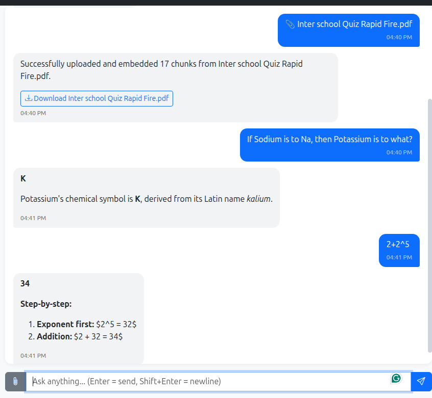
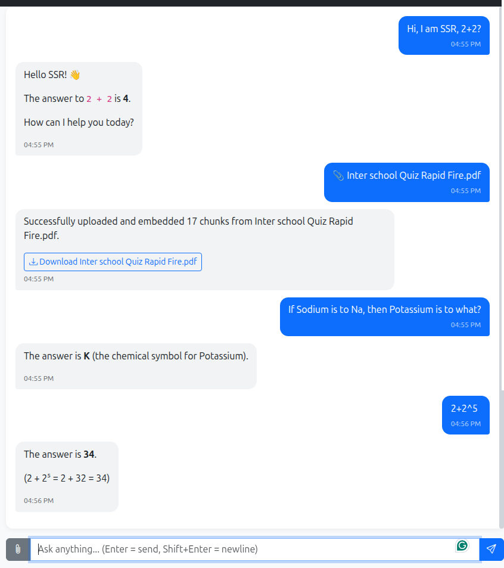

# Branch 008: `genai-chat-008-agent-tools` 🚀

**Goal:** 
Transform the chatbot into an autonomous AI Agent by implementing Function Calling (Tool Calling). The AI will be able to decide on its own when to use external tools (like a Calculator or Web Search) instead of hallucinating answers.

---

## 🧠 LLM Selection Strategy: the full discussion

Before writing any tool code we had to answer one question: **which model will actually call the tools?** This section records how we got to the answer, including the options we rejected, so the decision is easy to revisit later.

### 1. The starting problem

- Tool calling means the model must output a **structured JSON request** (for example `{"tool": "calculate", "expression": "1234 * 5678"}`) at the right moment, and stay silent about tools when they are not needed.
- Our current local models (`qwen2.5:1.5b` and `llama3.2:1b`) are too small for this. We already saw them fail at much simpler things in Branch 002 (the "I am SSR, 2+2?" confusion).
- The development machine is a **16 GB RAM laptop** that also runs the IDE, a browser, MySQL, Redis and the Django server. That limits what can run locally.

### 2. Models we looked at

We started from a list of the big open-source and open-weight model families: DeepSeek, Llama, Qwen and Google Gemma. The question was which of them can run on this laptop *and* handle tool calling.

| Model | What it is good at | Can it run on this laptop? | Verdict |
|-------|--------------------|----------------------------|---------|
| Llama 3.1 8B | Most widely used open model for function calling; reliable JSON output | On paper yes (about 4.7 GB), but too heavy next to the IDE, MySQL and browser | Best local choice if the hardware allowed it |
| Qwen 2.5 7B | Good at tool calling and multilingual text, including Hindi | Same problem as the 8B model | Second choice |
| Qwen 2.5 3B | Much smarter than 1.5B, produces JSON reasonably well | Yes (about 1.9 GB) | Candidate for "Plan B" (below) |
| Llama 3.2 3B | Small but capable, supports tool calling | Yes (about 2 GB) | Candidate for "Plan B" |
| Phi-3 Mini | Good reasoning and maths for its size | Yes (about 2.3 GB) | Considered, but we did not verify its tool calling |
| DeepSeek R1 / V3 | Deep reasoning, maths, coding | No, far too large locally | Only useful through an API |
| Llama 3.3 70B | Strong tool calling | No (needs tens of GB) | Only through an API |
| Gemma | Lightweight, multimodal | Small versions can run locally | Mainly reachable through Google AI Studio |

The honest summary: the models that are good at tool calling are either too big for this laptop, or (at 3B) borderline.

### 3. Plan B: stay fully local with a 3B model

If cloud is not an option, the fallback is a 3B model:

```bash
ollama pull qwen2.5:3b
```

```env
OLLAMA_MODEL=qwen2.5:3b
OLLAMA_MODEL_FAST=qwen2.5:1.5b
```

To make this safer, add a **Python-level fallback** so we do not depend on the model alone: if the question contains maths symbols such as `+`, `-`, `*` or `/` together with numbers, call the calculator directly. The catch is false positives (for example "2-3 days"), so the check should look for a real arithmetic expression, not just a symbol.

### 4. Website vs API

A point that is easy to miss: the free chat **websites** (DeepSeek Chat, Meta AI, Hugging Face Chat, Google AI Studio's chat) are user interfaces for people. Our Django app cannot talk to them. It needs an **API**, a programmatic endpoint that takes a message and returns JSON.

So "this model is free on a website" does not mean "we can use it in the app". We need a provider that offers a free API.

### 5. Free cloud API options evaluated

1. **OpenRouter (selected ✅):** one API key gives access to many models (DeepSeek R1, Llama 3.3 70B, Qwen 2.5 72B and more). It is OpenAI-compatible, so our existing `openai` SDK code keeps working; only the base URL and model name change. Free variants have a `:free` suffix on the model name.
2. **Groq:** the fastest option (Llama 3.3 70B), great for instant streaming, and it supports tool calling. We chose OpenRouter for model variety, but Groq stays a good second option.
3. **DeepSeek API:** the official API is cheap and OpenAI-compatible, but it only gives us DeepSeek models.
4. **Google AI Studio:** the official route to Gemma and Gemini, but it uses a different client library, so it is not a drop-in change for our code. We judged Llama 3.3 the safer choice for tool calling.

### 6. Decision: a hybrid approach

- **Local (Ollama):** keep `qwen2.5:1.5b` for fast, simple chat, with no internet required.
- **Cloud (OpenRouter):** use `meta-llama/llama-3.3-70b-instruct:free` for **Agent Tools**, where reasoning quality matters most.

In practice this is a provider switcher: local when you want privacy and offline use, cloud when you need a smarter model.

> ℹ️ Free model names and limits change over time. Check OpenRouter's model list before relying on a specific `:free` model.

### 7. Trade-offs we accept with the cloud option

- **Privacy:** the main README promises that no data leaves the machine. With a cloud provider, the user's message and any retrieved document text are sent to a third party. This matters especially after the security work in Branch 007, and it should be stated clearly in the docs and, ideally, in the UI.
- **Rate limits and availability:** free tiers have request limits, and a free model can be slow or temporarily unavailable.
- **Internet dependency:** cloud mode does not work offline. Local mode still does.

### 8. How to connect OpenRouter

**1. Get an API key.** Sign up on OpenRouter, open the **Keys** section and create a key (it starts with `sk-or-v1-`).

**2. Configure `.env`:**

```env
# ---- LLM Provider ----
# 'ollama' (local) or 'openai' (cloud)
LLM_PROVIDER=openai

# ---- OpenRouter settings ----
OPENAI_API_KEY=sk-or-v1-xxxxxxxxxxxxxxxxxxxxxxxx
OPENAI_BASE_URL=https://openrouter.ai/api/v1
#OPENAI_MODEL=meta-llama/llama-3.3-70b-instruct:free # 'This model is unavailable for free. The paid version is available now - use this slug instead: meta-llama/llama-3.3-70b-instruct
OPENAI_MODEL=openrouter/free
```

> ⚠️ The API key is a secret. It lives in `.env`, which must stay out of Git.

**3. Read the base URL in `local_settings.py`:**

```python
OPENAI_BASE_URL = os.getenv("OPENAI_BASE_URL", "https://api.openai.com/v1")
```

**4. Use it in `chat/utilities/llms/llm.py`** by updating `_create_client`:

```python
def _create_client(self) -> tuple[AsyncOpenAI, str]:
    if settings.LLM_PROVIDER == "ollama":
        return (
            AsyncOpenAI(base_url=settings.OLLAMA_BASE_URL, api_key="ollama"),
            settings.OLLAMA_MODEL,
        )

    # OpenAI / OpenRouter
    return (
        AsyncOpenAI(
            api_key=settings.OPENAI_API_KEY,
            base_url=getattr(settings, "OPENAI_BASE_URL", "https://api.openai.com/v1"),
        ),
        settings.OPENAI_MODEL,
    )
```

**5. Restart the server and test** with a normal question. The answer should now come from the 70B model, without using any laptop RAM.

<details>
<summary><b>🇮🇳 हिंदी में समझें (Click to expand Hindi Explanation) - LLM Selection Strategy</b></summary>

<br>

कोई भी tool का code लिखने से पहले हमें एक सवाल हल करना था: **tool कौन सा model चलाएगा?** यह उसी पूरी चर्चा का Hindi रूप है, ताकि बाद में भी याद रहे कि हमने क्या चुना और क्या छोड़ा।

**1. शुरुआती समस्या**

- Tool calling में model को सही समय पर एक **structured JSON** देना पड़ता है (जैसे `{"tool": "calculate", "expression": "1234 * 5678"}`), और जब tool की ज़रूरत न हो तब चुप रहना भी पड़ता है।
- हमारे मौजूदा local models (`qwen2.5:1.5b` और `llama3.2:1b`) इसके लिए बहुत छोटे हैं। Branch 002 में हम देख चुके हैं कि वे "I am SSR, 2+2?" जैसी आसान चीज़ में भी उलझ जाते हैं।
- Development वाले लैपटॉप में **16 GB RAM** है, और उसी में IDE, browser, MySQL, Redis और Django server भी चलते हैं। इसलिए local में क्या चल सकता है, इसकी सीमा है।

**2. कौन-कौन से models देखे**

हमने बड़े open-source और open-weight model families (DeepSeek, Llama, Qwen, Google Gemma) की सूची से देखा कि कौन सा इस लैपटॉप पर चल भी सकता है और tool calling भी कर सकता है।

| Model | किसमें अच्छा है | क्या इस लैपटॉप पर चलेगा? | नतीजा |
|-------|-----------------|--------------------------|-------|
| Llama 3.1 8B | Function calling के लिए सबसे ज़्यादा इस्तेमाल होने वाला open model, भरोसेमंद JSON | कागज़ पर हाँ (लगभग 4.7 GB), पर IDE, MySQL और browser के साथ भारी पड़ता है | हार्डवेयर होता तो सबसे अच्छा local विकल्प |
| Qwen 2.5 7B | Tool calling और multilingual (Hindi सहित) में अच्छा | 8B जैसी ही दिक्कत | दूसरा विकल्प |
| Qwen 2.5 3B | 1.5B से काफ़ी समझदार, ठीक-ठाक JSON देता है | हाँ (लगभग 1.9 GB) | "Plan B" का उम्मीदवार |
| Llama 3.2 3B | छोटा पर सक्षम, tool calling सपोर्ट करता है | हाँ (लगभग 2 GB) | "Plan B" का उम्मीदवार |
| Phi-3 Mini | अपने साइज़ के हिसाब से अच्छी reasoning और maths | हाँ (लगभग 2.3 GB) | सोचा, पर इसकी tool calling हमने जाँची नहीं |
| DeepSeek R1 / V3 | गहरी reasoning, maths, coding | नहीं, local के लिए बहुत बड़ा | सिर्फ़ API से |
| Llama 3.3 70B | मज़बूत tool calling | नहीं (दसियों GB चाहिए) | सिर्फ़ API से |
| Gemma | हल्का, multimodal | छोटे versions local चल सकते हैं | मुख्य रूप से Google AI Studio से |

सीधी बात: जो models tool calling में अच्छे हैं, वे या तो इस लैपटॉप के लिए बहुत बड़े हैं, या (3B पर) बस किनारे पर हैं।

**3. Plan B: 3B model के साथ पूरी तरह local रहना**

अगर cloud नहीं चलता, तो 3B model एक विकल्प है:

```bash
ollama pull qwen2.5:3b
```

```env
OLLAMA_MODEL=qwen2.5:3b
OLLAMA_MODEL_FAST=qwen2.5:1.5b
```

इसे और सुरक्षित बनाने के लिए **Python-level fallback** रखें, ताकि सिर्फ़ model के भरोसे न रहना पड़े: अगर सवाल में संख्याओं के साथ `+`, `-`, `*` या `/` जैसे गणित के चिह्न हों, तो सीधे Calculator चला दें। ध्यान रहे, "2-3 days" जैसे वाक्यों में यह गलत चल सकता है, इसलिए सिर्फ़ चिह्न नहीं, असली arithmetic expression जाँचें।

**4. Website बनाम API**

एक बात जो आसानी से छूट जाती है: DeepSeek Chat, Meta AI, Hugging Face Chat जैसी free **websites** इंसानों के लिए बने interface हैं। हमारा Django app उनसे बात नहीं कर सकता। उसे **API** चाहिए, यानी ऐसा endpoint जो message ले और JSON में जवाब दे।

इसलिए "यह model website पर free है" का मतलब यह नहीं कि हम उसे app में इस्तेमाल कर सकते हैं। हमें ऐसा provider चाहिए जो free API भी दे।

**5. Free Cloud API के विकल्प**

1. **OpenRouter (चुना गया ✅):** एक API key से कई models (DeepSeek R1, Llama 3.3 70B, Qwen 2.5 72B वगैरह)। यह OpenAI-compatible है, इसलिए हमारा `openai` SDK वाला code चलता रहता है; सिर्फ़ base URL और model का नाम बदलता है। Free versions के नाम के अंत में `:free` लगता है।
2. **Groq:** सबसे तेज़ (Llama 3.3 70B), instant streaming के लिए बढ़िया, और tool calling सपोर्ट करता है। हमने model की विविधता के लिए OpenRouter चुना, पर Groq अच्छा दूसरा विकल्प है।
3. **DeepSeek API:** आधिकारिक API सस्ता और OpenAI-compatible है, पर इससे सिर्फ़ DeepSeek के models मिलते हैं।
4. **Google AI Studio:** Gemma और Gemini का आधिकारिक रास्ता, पर इसके लिए अलग client library चाहिए, इसलिए हमारे code में सीधा बदलाव नहीं है। हमने tool calling के लिए Llama 3.3 को ज़्यादा सुरक्षित माना।

**6. फ़ैसला: Hybrid approach**

- **Local (Ollama):** सादा और तेज़ chat के लिए `qwen2.5:1.5b`, बिना internet के।
- **Cloud (OpenRouter):** **Agent Tools** के लिए `meta-llama/llama-3.3-70b-instruct:free`, जहाँ reasoning की गुणवत्ता सबसे ज़्यादा मायने रखती है।

व्यवहार में यह एक provider switcher है: privacy और offline काम के लिए local, और ज़्यादा समझदार model चाहिए तो cloud।

> Free models के नाम और limits समय के साथ बदलते हैं। किसी `:free` model पर निर्भर होने से पहले OpenRouter की model list देख लें।

**7. Cloud चुनने के trade-offs**

- **Privacy:** main README में लिखा है कि कोई data मशीन से बाहर नहीं जाता। Cloud provider के साथ user का message और retrieved document का text तीसरे पक्ष को जाता है। Branch 007 की सुरक्षा के बाद यह और भी मायने रखता है, इसलिए docs में (और हो सके तो UI में) साफ़ लिखना चाहिए।
- **Rate limits और availability:** free tier की request limits होती हैं, और free model धीमा या कभी-कभी बंद हो सकता है।
- **Internet पर निर्भरता:** Cloud mode offline नहीं चलता। Local mode चलता है।

**8. OpenRouter कैसे जोड़ें**

1. **API key लें:** OpenRouter पर sign up करें, **Keys** section में जाकर key बनाएँ (यह `sk-or-v1-` से शुरू होती है)।
2. **`.env` में configure करें:**

   ```env
   LLM_PROVIDER=openai
   OPENAI_API_KEY=sk-or-v1-xxxxxxxxxxxxxxxxxxxxxxxx
   OPENAI_BASE_URL=https://openrouter.ai/api/v1
   OPENAI_MODEL=meta-llama/llama-3.3-70b-instruct:free
   ```

   > API key एक secret है। उसे `.env` में रखें और Git में कभी न डालें।

3. **`local_settings.py` में base URL पढ़ें:**

   ```python
   OPENAI_BASE_URL = os.getenv("OPENAI_BASE_URL", "https://api.openai.com/v1")
   ```

4. **`chat/utilities/llms/llm.py` के `_create_client` को अपडेट करें** (पूरा code ऊपर English वाले हिस्से में दिया है): जब `LLM_PROVIDER` `ollama` न हो, तो `AsyncOpenAI` को `api_key=settings.OPENAI_API_KEY` और `base_url=settings.OPENAI_BASE_URL` के साथ बनाएँ।
5. **Server restart करें** और कोई सामान्य सवाल पूछें। अब जवाब 70B model से आएगा, और लैपटॉप की RAM बिल्कुल खर्च नहीं होगी।

</details>

---

## 🛠️ Tools in this Branch

### 1. Calculator Tool ✅

- **Problem:** LLMs are bad at math (as seen with `2+2` in Branch 001). They predict text, they don't calculate.
- **Solution:** a Python function `calculate(expression)` in `chat/utilities/tools.py` that parses the expression with Python's `ast` module (no `eval()`) and computes exact math. The model asks for it through a tool call, Django runs it, and the result goes back to the model.
- **Status:** implemented and working for plain arithmetic. One part is still to be verified (see "What is still open" below).

The two test runs below show what went wrong along the way and how each problem was found. For each one I kept the screenshot and the matching server log side by side, because the screenshot alone was misleading.

#### Test 1: the right answer, but the tool had failed

[](docs/screenshot_008_01.png)

*Screenshot 1: PDF upload and RAG answer (`K`), then `2+2^5` answered with `34` and a step-by-step explanation: [`docs/screenshot_008_01.png`](docs/screenshot_008_01.png)*

**What the screenshot shows.** Everything looks fine. The PDF was indexed, the RAG question about sodium and potassium returned `K`, and `2+2^5` returned `34` with the steps. Only one detail is off: the steps contain raw `$2^5 = 32$`, which is LaTeX that the chat window does not render.

**What the log shows.**

```text
[ERROR] chat.utilities.llms.llm: Query rewrite failed: 'NoneType' object has no attribute 'strip'
[INFO]  chat.utilities.llms.llm: 🔍 [RAG] Found 0 docs and 0 memories for query: '2+2^5'
[INFO]  chat.utilities.llms.llm: 🛠️ Tool Calls Requested: [{'function': {'name': 'calculate', 'arguments': '{"expression":"2+2^5"}'}}]
[INFO]  chat.utilities.llms.llm: 🧮 Calculating: 2+2^5
[ERROR] chat.utilities.tools: Calculator error for '2+2^5': <class 'ast.BitXor'>
[INFO]  chat.utilities.llms.llm: 🔄 Calling LLM again with tool results...
[INFO]  chat.utilities.llms.llm: 🏁 [STREAM END] Total generated: 0 chars.
```

The model did call the tool, but the calculator **rejected the expression** (`ast.BitXor`) and returned an error. The model then recovered on its own and computed `34` itself. So the answer was right, but it did not come from our calculator. Without reading the log, I would have believed the tool worked.

#### Test 2: after the fix

[](docs/screenshot_008_02.png)

*Screenshot 2: `Hi, I am SSR, 2+2?`, then the PDF upload, the RAG answer and `2+2^5`: [`docs/screenshot_008_02.png`](docs/screenshot_008_02.png)*

```text
[INFO]  ▶️ [STREAM START] User: Hi, I am SSR, 2+2?, Session: 1
[INFO]  🛠️ Tool Calls Requested: [{'function': {'name': 'calculate', 'arguments': '{"expression":"2+2"}'}}]
[INFO]  🧮 Calculating: 2+2
...
[INFO]  ▶️ [STREAM START] User: 2+2^5, Session: 1
[ERROR] Query rewrite failed: 'NoneType' object has no attribute 'strip'
[INFO]  🔍 [RAG] Found 0 docs and 2 memories for query: '2+2^5'
[INFO]  ⏳ Calling LLM API...
[INFO]  🏁 [STREAM END] Total generated: 47 chars.
```

Two things to note:

- **`Hi, I am SSR, 2+2?` now works, and it went through the tool.** This is the very sentence that confused the small models in [Branch 002](README.002.md) ("SSR is a Russian military unit..."). A 70B model plus a calculator tool handles it without trouble.
- **`2+2^5` was answered *without* calling the tool.** There is no `Tool Calls Requested` line for it, so the model answered from its own knowledge (correctly). That means this run does **not** prove that the `^` fix works. See the next steps below.

#### Issues and solutions

| # | Issue | Cause | Solution | Status |
|---|-------|-------|----------|--------|
| 1 | `module 'ast' has no attribute 'Num'` | The code used `ast.Num`. It has been deprecated since Python 3.8 and was removed in Python 3.14, which this project runs. | Use `ast.Constant` instead. | ✅ Fixed |
| 2 | `Calculator error ... ast.BitXor` for `2+2^5` | In Python `^` means bitwise XOR, not "power". The safe evaluator only allows whitelisted operators, so it refused it. Users and LLMs write `^` for powers. | Replace `^` with `**` before parsing, and add `ast.Pow` to the allowed operators. | ✅ Fix added, ⏳ not yet confirmed through a real tool call |
| 3 | `Query rewrite failed: 'NoneType' object has no attribute 'strip'` | The free OpenRouter model sometimes returns empty content, and the code called `.strip()` on `None`. | Check that the content exists before calling `.strip()`; otherwise fall back to the original question. | ⏳ Fix prepared. The error still appears in the Test 2 log, so re-test after applying it. |
| 4 | Raw `$2^5 = 32$` shown in the answer (Screenshot 1) | The model answers in LaTeX, and the chat window only renders Markdown. | Either tell the model not to use LaTeX in the system prompt, or add a math renderer such as KaTeX to the UI. | ⏳ Open. In Screenshot 2 the model happened to write plain text. |
| 5 | Log says `Total generated: 0 chars` although an answer is shown | Most likely the counter only measures the first (tool-call) pass, not the answer streamed after the tool result. | Count the characters of both passes. | ⏳ To check |

#### The fixes

`chat/utilities/tools.py`:

```python
import ast
import logging
import operator

logger = logging.getLogger(__name__)

# Only these operators are allowed
OPERATORS = {
    ast.Add: operator.add,
    ast.Sub: operator.sub,
    ast.Mult: operator.mul,
    ast.Div: operator.truediv,
    ast.Pow: operator.pow,   # handles ** (power)
    ast.USub: operator.neg,
}

def calculate(expression: str) -> str:
    """Safely evaluate a mathematical expression."""
    try:
        # '^' is XOR in Python, but people mean "power"
        expression = expression.replace("^", "**")
        node = ast.parse(expression, mode="eval").body

        def _eval(node):
            if isinstance(node, ast.Constant):      # ast.Num no longer exists
                return node.value
            elif isinstance(node, ast.BinOp):
                return OPERATORS[type(node.op)](_eval(node.left), _eval(node.right))
            elif isinstance(node, ast.UnaryOp):
                return OPERATORS[type(node.op)](_eval(node.operand))
            raise TypeError(f"Unsupported operation: {type(node)}")

        return str(_eval(node))
    except Exception as e:
        logger.error(f"Calculator error for '{expression}': {e}")
        return f"Error: Could not calculate '{expression}'"
```

`chat/utilities/llms/llm.py`, inside `_rewrite_query`:

```python
content = resp.choices[0].message.content
if content:
    rewritten = content.strip()
    logger.info(f"🔄 Query Rewritten: '{user_message}' -> '{rewritten}'")
    return rewritten
return user_message
```

#### What is still open

- **Prove the `^` fix.** Ask something the model cannot easily do in its head, such as `1234 * 5678` (the answer is `7006652`) or `7^13`, and check that the log shows `Tool Calls Requested` and no `Calculator error`.
- **Apply and re-test the `_rewrite_query` fix** (issue 3), then check that the error is gone from the log.
- **Decide how to handle LaTeX** (issue 4) and **check the character counter** (issue 5).
- **Limit the exponent.** Now that `**` is allowed, an input like `9**9**9` can make the server hang. Cap the size of the numbers or exponents before evaluating. This matters after the security work in Branch 007.

#### Lesson from this debugging

A correct answer on screen does not prove the tool worked. The only reliable evidence was the server log, so every tool call should be logged with its result, not just its request.

<details>
<summary><b>🇮🇳 हिंदी में समझें (Click to expand Hindi Explanation) - Calculator Tool: समस्या और समाधान</b></summary>

<br>

**Calculator Tool क्या करता है?**

LLM गणित में कमज़ोर होते हैं, क्योंकि वे अगला शब्द अनुमान लगाते हैं, गणना नहीं करते। इसलिए हमने `chat/utilities/tools.py` में `calculate(expression)` बनाया, जो `ast` से expression को सुरक्षित तरीके से parse करके सही नतीजा निकालता है (`eval()` नहीं)। Model tool call माँगता है, Django उसे चलाता है, और नतीजा वापस model को जाता है।

**Test 1 (Screenshot 1): जवाब सही, पर tool फ़ेल**

- Screenshot में सब ठीक दिखा: PDF index हुई, RAG ने `K` ढूँढा, और `2+2^5` का जवाब `34` आया।
- लेकिन server log में दिखा कि model ने `calculate` tool माँगा, और Calculator ने `2+2^5` को **reject** कर दिया (`ast.BitXor`), क्योंकि Python में `^` का मतलब XOR होता है, power नहीं। इसके बाद model ने खुद ही `34` निकाल लिया। यानी जवाब सही था, पर हमारे calculator से नहीं आया।
- Screenshot में `$2^5 = 32$` जैसा raw LaTeX भी दिखा, क्योंकि chat window सिर्फ़ Markdown दिखाती है, math नहीं।

**Test 2 (Screenshot 2): fix के बाद**

- `Hi, I am SSR, 2+2?` का जवाब सही आया और इस बार tool से आया। यही वह वाक्य है जिसने Branch 002 में छोटे models को उलझा दिया था।
- पर `2+2^5` के लिए log में tool call की कोई line नहीं है। Model ने खुद जवाब दे दिया (सही), इसलिए इस run से यह साबित नहीं होता कि `^` वाला fix काम करता है।

**समस्याएँ और समाधान**

| # | समस्या | कारण | समाधान | स्थिति |
|---|--------|------|--------|--------|
| 1 | `ast.Num` का error | `ast.Num` Python 3.8 से deprecated था और 3.14 में हटा दिया गया, जो इस project में है | `ast.Constant` इस्तेमाल करें | ✅ ठीक |
| 2 | `^` पर `ast.BitXor` error | Python में `^` XOR है, power नहीं | parse करने से पहले `^` को `**` से बदलें और `ast.Pow` allow करें | ✅ fix जोड़ा, ⏳ असली tool call से पुष्टि बाकी |
| 3 | `Query rewrite failed: 'NoneType'... 'strip'` | Free model कभी-कभी खाली जवाब देता है | `.strip()` से पहले जाँचें कि content है, वरना original सवाल इस्तेमाल करें | ⏳ fix तैयार, दोबारा test करना है |
| 4 | जवाब में raw `$...$` LaTeX | Model LaTeX में लिखता है, UI उसे render नहीं करती | System prompt में LaTeX मना करें, या UI में KaTeX जोड़ें | ⏳ खुला |
| 5 | Log में `Total generated: 0 chars` | शायद counter सिर्फ़ पहले (tool-call) pass को गिनता है | दोनों passes गिनें | ⏳ जाँचना है |

**अभी क्या बाकी है**

- `1234 * 5678` (जवाब `7006652`) या `7^13` पूछकर देखें कि log में `Tool Calls Requested` आए और `Calculator error` न आए।
- `_rewrite_query` का fix लगाकर दोबारा test करें।
- `**` अब allowed है, इसलिए `9**9**9` जैसा input server को अटका सकता है। Exponent की सीमा तय करें (Branch 007 की सुरक्षा के लिहाज़ से ज़रूरी)।

**सबक:** स्क्रीन पर सही जवाब का मतलब यह नहीं कि tool चला। असली सबूत server log में था, इसलिए हर tool call का नतीजा भी log होना चाहिए।

</details>

### 2. Web Search Tool (Optional/Future)
- **Problem:** The AI's knowledge is limited to its training data (cutoff date).
- **Solution:** A tool that queries a search engine (like Tavily or DuckDuckGo) and returns real-time results. It needs a free search API, so it comes after the calculator.

### 3. Database Query Tool (Planned, last)
- **Use case:** questions such as "how many chats do I have?" or "how many files did I upload?".
- **Approach:** a read-only query, scoped to the logged-in user. This is the riskiest tool for data leaks, which is why Branch 007 (security hardening) comes first.

### Order of work
1. ✅ Build the calculator in `tools.py`.
2. ✅ Add the function-calling logic in `LLMService`.
3. ✅ Connect OpenRouter so a capable model is available.
4. Add web search and the database query tool last.

---

## 🏗️ Architecture (How Tool Calling Works)

1. User sends a message (e.g., "What is 1234 * 5678?").
2. Django sends the message + a list of **available tools** to the LLM.
3. The LLM does not answer directly. Instead, it outputs a `tool_call` JSON: `{"tool": "calculate", "expression": "1234 * 5678"}`.
4. Django executes the Python `calculate()` function and gets `7006652`.
5. Django sends this result back to the LLM.
6. The LLM generates the final natural language answer: *"The answer is 7,006,652."*

---

## 🎓 Educational Takeaways

1. **Hardware is a real constraint:** Not everyone has an RTX 4090. Cloud APIs bridge the gap between local hardware limitations and the need for powerful reasoning.
2. **A free website is not a free API:** A chat UI is for people. A Django app needs an API endpoint.
3. **OpenAI SDK is the industry standard:** Because Ollama, OpenRouter, and Groq all support the OpenAI format, we can switch providers by changing just a few lines in `.env`.
4. **Cloud has a price even when it is free:** privacy, rate limits and internet dependence. Know what you give up.
5. **Do not trust the model alone:** a simple Python fallback for the calculator makes the app work even when a small model fails to call the tool.
6. **Tool Calling is the future:** A chatbot that just talks is limited. An agent that can calculate, search, and query databases is exponentially more useful.

---

<details>
<summary><b>🇮🇳 हिंदी में समझें (Click to expand Hindi Explanation)</b></summary>

<br>

**इस ब्रांच का मकसद:**
चैटबॉट को एक AI Agent में बदलना, जो अपनी बुद्धि से तय करे कि कब बाहरी tools (जैसे Calculator) का इस्तेमाल करना है।

**LLM चुनने की पूरी चर्चा:** इसका पूरा Hindi रूप ऊपर "LLM Selection Strategy" वाले section के नीचे अलग block में है। संक्षेप में: सादा chat के लिए local `qwen2.5:1.5b`, और Agent Tools के लिए OpenRouter का `llama-3.3-70b-instruct:free` (Hybrid approach)।

**मुख्य बदलाव:**
- **Calculator:** गणित के सवाल सटीकता से हल करने के लिए।
- **Tool Calling:** अब AI खुद समझेगा कि जवाब देने के लिए Calculator चलाना है, और JSON में request देगा।
- **काम का क्रम:** पहले Calculator, फिर function-calling logic, फिर OpenRouter, और सबसे आख़िर में Web Search और Database query।

</details>